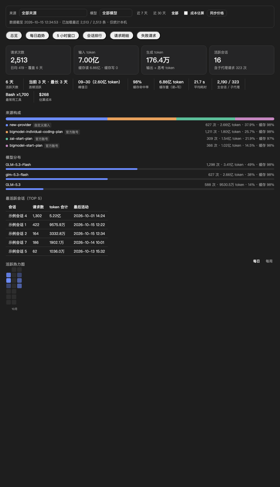
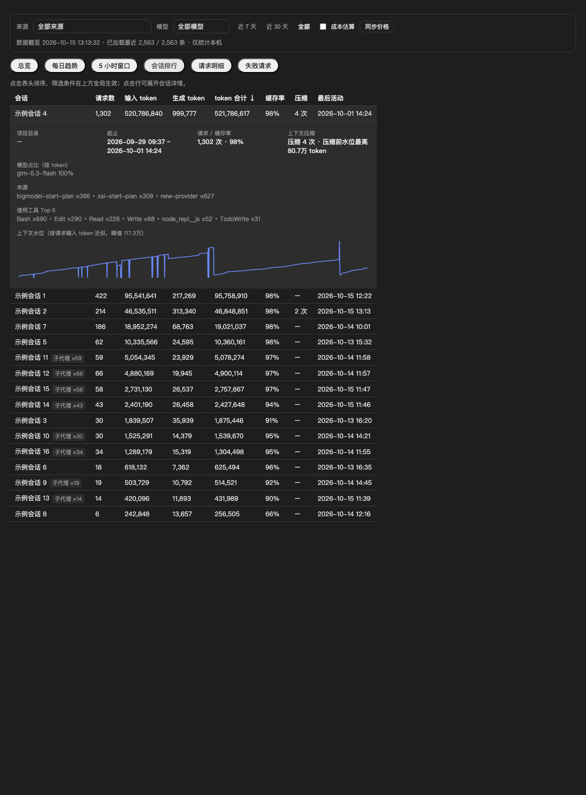
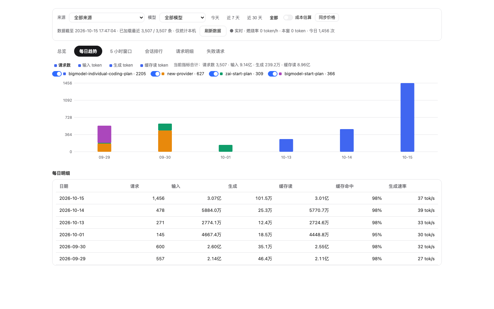
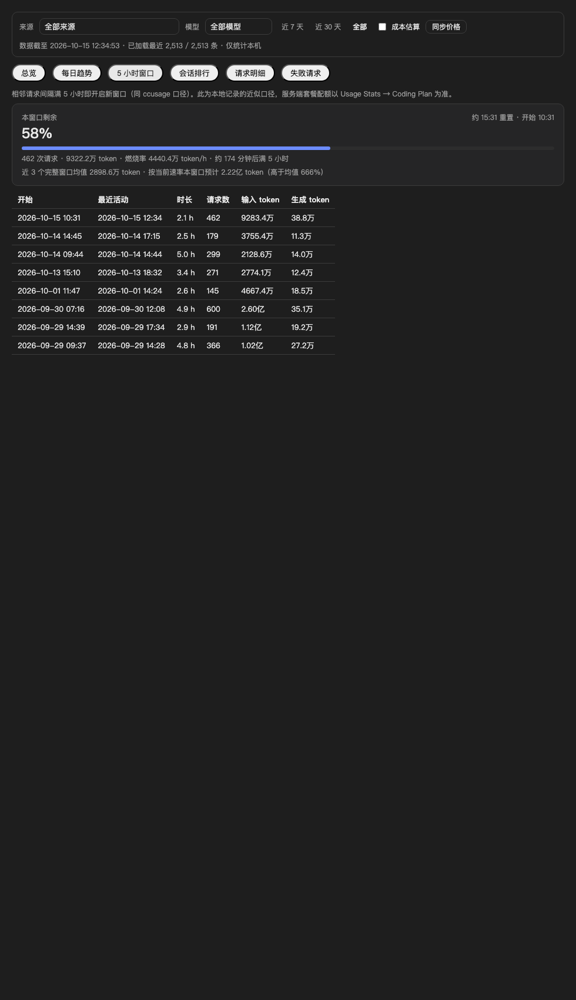
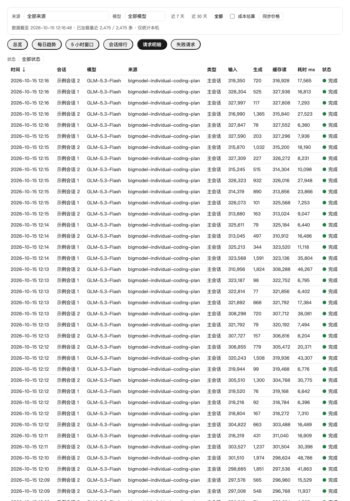

# ZCode 用量明细 (usage-detail)

[English](#english) | 简体中文

一个 [ZCode](https://zcode.z.ai) 插件：查看**每一次模型请求**的本地用量明细——逐条记录、按来源（GLM 官方套餐 / 自定义 BYOK 接入）区分、多维筛选与交互式仪表盘。

纯本地只读查询，**不发起任何网络请求，不上传任何数据**。



会话排行支持点击展开：上下文压缩、模型占比、使用工具、上下文水位曲线一目了然：



每日趋势按来源堆叠，官方套餐与 BYOK 一目了然：



5 小时窗口实时燃烧率（当前速率 vs 近期窗口均值）：



## 功能

- **逐条明细**：每次模型请求一行——时间、会话、模型、来源、主会话/子代理、输入/缓存读/缓存写/生成/合计 token、耗时、首字延迟、**输出速率 tok/s**（六档变色）、状态、每行估算成本（开关）；分页浏览、点表头排序
- **会话侧栏面板**（ZCode Desktop 3.15+）：**与 `/usage-ui` 完整版同一份界面**（不是简化版）——六个标签页、热力图、趋势、5 小时窗口、会话钻取、请求分页/排序/钻取全部可用，明暗主题跟随宿主，由插件内置零依赖 MCP 服务按需生成（默认**内嵌全部历史**，插件设置里可自定义数据库路径与聚合条数）。图表悬停即时显示明细（含 token 与缓存率）；时段分布支持「请求 / token」指标切换；明细分页支持页码直跳
- **每轮用量统计行**：开启后每条调用了工具的回复末尾自动附一行本问统计——输出速率 tok/s、首字延迟、输入（含缓存命中率）、生成、请求数、本轮耗时与会话累计，模型按注入指令在收尾前自测本地数据库生成，非估算值
- **两级钻取**：点击会话行展开该会话详情——项目目录、起止、上下文压缩次数与压缩前水位、模型占比（按 token）、来源分布、使用工具 Top 6、**上下文水位曲线**；点击请求行展开该条完整信息——Token 构成（输入/缓存读/缓存写/生成）、时序（总耗时/首字占比），本地面板模式还能查看 provider 上报的**原始用量 JSON**
- **当前会话**（感谢 [@Garfielk](https://github.com/Garfielk)）：`/usage-this` 查看当前会话汇总、按模型/来源分组和最近失败/取消请求；`/usage-this-ui` 使用精简面板，首屏展示请求/输入/生成/缓存读，模型分布和请求明细按需展开，支持直接查看失败/取消记录
- **来源区分**：自动区分 `account:*` 官方套餐（如 GLM Coding Plan）与自定义/BYOK 接入，仪表盘按来源堆叠展示每日趋势
- **交互式仪表盘**（`/usage-ui`）：总览 / 每日趋势 / 5 小时窗口 / 会话排行 / 请求明细 / 失败请求六个标签页；来源、模型、时间范围（近 7 天 / 30 天 / 全部）全局筛选即时生效；请求明细**分页浏览**（每页 50 条 + 页码直跳）；表格点击表头排序；界面自动适配 ZCode 明暗主题。**默认内嵌全部历史**，`/usage-ui <条数>` 可限制（1–20000；会话内嵌渲染有体积上限，超大的历史建议用本地面板或侧栏）
- **5 小时窗口**：按相邻请求间隔 ≥5h 切分用量窗口（同 ccusage 口径），当前窗口显示进行中进度与剩余时间
- **缓存率全链路**：缓存命中率、缓存量（读+写）进洞察；来源构成、模型分布、会话排行、请求明细逐项带缓存率
- **悬停明细**：热力图、趋势图、时段分布鼠标悬停即时显示完整用量分解
- **洞察指标**：活跃天数、当前/最长连续活跃、峰值日、缓存命中率、缓存量（读+写）、任务完成率（todo）、重试/取消、平均耗时、主会话/子代理拆分、最常用工具、峰值时段、数据体量体检（日志/导出/库）
- **活跃热力图**：GitHub 提交风格，按天 token 四分位着色，悬停看当日明细
- **成本估算**（默认官方价）：内置从 [models.dev](https://models.dev) 打包的官方牌价（覆盖 GLM 全系）；`prices sync` 可**全量同步 models.dev 所有供应商模型价**（BYOK 场景下的 Claude / GPT / DeepSeek / Qwen 等都支持），自定义条目不会被覆盖；仪表盘有"成本估算"开关与"同步价格"按钮
- **分时计价**：支持按请求本地时间取档的峰/谷/夜间价格（官方套餐高峰/低峰时段单价不同、其他模型同理），在价格表里加 `tariff` 字段即可生效：

  ```json
  { "currency": "USD",
    "models": { "glm-5.3": { "in": 1.4, "out": 4.4, "cache": 0.26,
      "tariff": { "tz": 8,
        "tiers": [
          { "hours": [[9, 12], [14, 18]], "mult": 1.0, "name": "峰" },
          { "hours": [[0, 8]], "mult": 0.5, "name": "谷" } ] } } } }
  ```

  不配置 `tariff` 时按基础价计算，行为不变。
- **套餐配额查询**（`quota`，CLI 可选）：余量显示因账号/套餐类型差异较大（客户端凭据为加密托管，日志并非对所有套餐包含 5 小时池/周池观测），**界面里不再渲染配额卡**——套餐余量请直接查看 ZCode 的 **Usage Stats → Coding Plan**（官方口径最准）。本子命令保留给需要它的 API Key 用户：写入 `~/.zcode/usage-quota-token.json`（`{"token":"你的KEY","base":"https://open.bigmodel.cn"}`）后可查监控接口
- **本地常驻面板**（`serve`）：一条命令在本机起一个只读 Web 服务，浏览器打开即得常驻看板——数据一次加载，燃烧率每 5 秒轻量轮询实时刷新，支持两级钻取与原始用量查看，不占会话上下文
- **导出**：`export csv` / `export json` 全量记录（CSV 遵循 RFC 4180）
- **零依赖**：只用 macOS / Linux 自带的 `bash` + `sqlite3`，不需要 Node / Python

数据来自 ZCode 客户端本地数据库 `~/.zcode/cli/db/db.sqlite`（只读）。

## 安装

### 方式一：添加 GitHub 市场源（推荐）

1. 打开 ZCode 的 **插件市场**
2. 点击 **添加 → 添加插件市场**，粘贴本仓库地址：

   ```
   https://github.com/axdlee/zcode-usage-detail
   ```

3. 添加后进入 **个人** 标签页，找到 **用量明细 (Usage Detail)**，点击 **安装**

### 方式二：本地目录

```bash
git clone https://github.com/axdlee/zcode-usage-detail.git
```

然后在 **插件市场 → 添加 → 添加插件市场** 粘贴克隆出的目录路径（即包含 `marketplace.json` 的那一层），后续步骤同上。

### 方式三：AI 一键安装

把下面这段话直接发给 ZCode（或任何编码智能体），它会替你完成剩余步骤：

```text
请帮我安装 GitHub 上的 zcode-usage-detail 插件：

1. 执行 git clone https://github.com/axdlee/zcode-usage-detail.git ~/.zcode/plugins/zcode-usage-detail（目录已存在则 git -C 拉取更新）
2. 校验插件清单：node /Applications/ZCode.app/Contents/Resources/glm/zcode.cjs plugins validate ~/.zcode/plugins/zcode-usage-detail/usage-detail（没有这个 CLI 就跳过）
3. 读完插件 README 的安装章节后，告诉我手动步骤：在 ZCode 的「插件市场 → 添加 → 添加插件市场」里粘贴 ~/.zcode/plugins/zcode-usage-detail，然后在「个人」标签安装「用量明细」插件
4. 最后给我一条验收提示：安装后新建任务运行 /usage-ui，应看到内嵌的用量仪表盘
```

## 使用

安装后**新建任务**：

| 输入 | 效果 |
|---|---|
| `/usage-ui` | 生成交互式仪表盘，内嵌渲染在会话中 |
| `/usage-ui 8000` | 同上，内嵌最近 8000 条 |
| `/usage-this` | 推断当前会话，显示身份、用量汇总、模型/来源与最近失败/取消请求 |
| `/usage-this-ui` | 当前会话的精简面板：四项用量统计、折叠模型分布与请求明细 |
| `/usage-this --session sess_xxx` | 显式指定会话（UI 命令同样支持） |
| `/usage-this --directory /绝对/项目路径` | 选择指定项目目录内最近请求的会话（UI 命令同样支持） |
| `/usage` | 文本总览（累计 + 今日） |
| `/usage blocks` | 5 小时窗口用量（含进行中的窗口） |
| `/usage recent 50` | 最近 50 条逐条明细 |
| `/usage providers` | 按来源（官方套餐 / 自定义接入）汇总 |
| `/usage months` | 按月汇总 |
| `/usage projects 10` | 按项目目录汇总 Top 10 |
| `/usage tools` | 工具调用统计 |
| `/usage cost` | 成本估算（内置官方价，可自定义价格表） |
| `/usage prices sync` | 从 models.dev 同步最新官方价 |
| `/usage quota` | 查询套餐配额余量（零密钥读客户端日志，可选 API Key 补充） |
| `/usage doctor` | 环境自检：数据库/表结构/价格表/配额数据源/依赖逐项排查（"统计不见了？"先跑这个） |
| `/usage export csv` | 导出全部记录为 CSV |
| `/usage day 2026-10-14` | 某天的逐条明细 |
| `/usage sessions 10` | 会话用量排行 Top 10 |
| `/usage errors` | 最近的失败/取消请求 |
| “看看我哪个会话最烧 token” | 自然语言同样可以，会自动路由到对应查询 |

### 当前会话定位

ZCode 命令环境尚未提供可靠的当前会话 ID，因此默认使用本地数据库中**最近一次模型请求的 `session_id`**，一次执行中固定该 ID。多窗口并行请求时可能定位到另一会话，请核对输出中的会话标题、ID 和最近请求时间；有歧义时用 `--session ID` 指定，或用 `--directory "项目绝对路径"` 限制候选范围（两者互斥）。目录匹配为精确匹配，可使用报告中的项目目录。

只统计所选 `session_id` 的请求，不递归合并其他 ID 的子会话。文本版统计全部状态，生成 token = 输出 + 思考；失败和取消单独计数，进行中的请求归入其他状态。正在进行的请求可能尚未写入完整 token，重新运行可刷新。

会话 UI 首屏展示标题、最近请求和四项用量；会话 ID、项目目录与创建时间可展开查看。模型分布和请求明细默认折叠，有失败/取消请求时可直接跳到对应筛选。会话排行、热力图、每日趋势和 5 小时窗口仍在全量 `/usage-ui` 中查看。

UI 在会话过滤后默认加载最近 3000 条，可用 `ZCODE_USAGE_LIMIT` 调整为 1-20000；超过时标注覆盖范围，卡片和明细均只统计已加载记录。结果是生成时的本地快照，不表示服务端套餐余量。

直接运行脚本：

```bash
bash usage-detail/scripts/usage.sh this
bash usage-detail/scripts/usage.sh this --session sess_xxx
bash usage-detail/scripts/usage.sh dashboard-this /tmp/usage-this.html --directory "/path/to/project"
```

### 会话侧栏面板怎么打开

1. 安装或更新插件后，**重启 ZCode**（宿主在启动时加载插件清单）
2. 打开任意一个会话，在**右侧面板**区域点击 **「+」新增标签**
3. 在列表里选择「**用量**」——面板即作为侧栏标签常驻，随会话自动刷新
4. 面板顶部「**完整面板 ↗**」会自动拉起本地常驻服务并打开完整仪表盘（分页明细、热力图、5 小时窗口、会话钻取等全部能力都在那里）

若列表里没有「用量」：确认插件已启用、ZCode 为 3.15+ 且已重启；仍不出现请运行 `/usage doctor` 排查。

### 每轮用量统计行

安装后新会话自动生效：每条调用了工具的回复末尾会附一行 `> 本轮用量：⚡ 82 tok/s · 首字 1.1s · 输入 45.2k tok（缓存 98%）· 生成 863 tok · 3 次请求 · 本轮 12.7s`。统计由模型在写回复前运行本地只读脚本自测，纯问答轮（无工具调用）不显示。开关：写入 `~/.zcode/usage-detail-turn.json` `{"disabled": true}` 并重开会话（或直接卸载插件）。

### 成本估算（默认官方价，可自定义）

价格表解析顺序：`ZCODE_USAGE_PRICES` 环境变量 → `~/.zcode/usage-prices.json`（你的文件）→ 插件内置官方价（打包自 [models.dev](https://models.dev)，美元/百万 token）。开箱即有官方价，无需配置。

- **每日自动同步**：生成仪表盘/启动面板时若价格表超过 1 天未更新，自动从 models.dev 全量同步（`ZCODE_USAGE_NO_AUTOSYNC=1` 关闭）
- `usage.sh prices show` 查看当前生效的价格表；`usage.sh prices sync` 手动全量同步所有供应商模型价（保留自定义条目；需要 node + curl）
- 仪表盘顶部"同步价格"按钮：会话内点击会请求 Agent 执行同步并重渲染，本地面板点击直接同步后刷新
- 自定义：编辑 `~/.zcode/usage-prices.json`，可加任意模型、改币种：

  ```json
  { "currency": "USD",
    "models": { "glm-5.3": {"in": 1.4, "out": 4.4, "cache": 0.26},
                 "my-private-model": {"in": 1, "out": 3, "cache": 0.1} } }
  ```

配置后 `/usage cost` 按模型拆分估算；仪表盘顶部出现"成本估算"开关，打开后会话排行与来源构成追加成本列。注意：订阅套餐（如 GLM Coding Plan）内的请求实际不按 token 计费，估算仅供 BYOK 按量计费或心理参考。

### 实时燃烧率监控

- 仪表盘"5 小时窗口"页：剩余百分比 + 重置时间点 + 燃烧率（token/小时）+ 与近 3 个完整窗口均值的对比和满窗预测 + **剩余请求估算**（按近 3 个完整窗口平均请求数，推算本窗口还可发起多少次）
- **本地常驻面板**：`usage.sh serve`（默认端口 7741，`serve 8080` 可换），自动打开浏览器。页面数据一次加载，燃烧率/今日用量每 5 秒轻量轮询刷新（只查最近 5h 数据，走索引，开销极低）；也可让 ZCode 里的 Agent 后台启动后把 `http://127.0.0.1:7741` 发给你。仅监听 127.0.0.1、只读、不写任何文件
- 终端监控（claude-monitor 风格）：`usage.sh live [秒]`，默认 3s 刷新、Ctrl-C 退出，适合挂在一个终端角落

### 仪表盘预览

每日趋势按来源堆叠，官方套餐与 BYOK 一目了然：


请求明细支持状态筛选与表头排序：



## 数据说明与隐私

- 数据源是 ZCode 客户端自动写入的本地 SQLite（`~/.zcode/cli/db/db.sqlite` 的 `model_usage` 表），本插件只做**只读**查询
- 不联网、不上传、不写库；仪表盘数据在生成时内嵌，仅存在于你自己机器上的一个 HTML 文件
- 仪表盘默认内嵌最近 3000 条请求，`/usage-ui <条数>` 可调整（1–20000；超过约 8000 条可能超出会话内嵌渲染的体积限制，全量历史请用 `export json`）
- token 口径：输入列含缓存命中（缓存读单独列出），生成 = 输出 + 思考
- **套餐配额余量**（5 小时池 / 周额度）由服务端计量，不在本地库中：`/usage quota` 优先零密钥解析客户端日志里的额度观测；因账号/套餐类型而异，部分观测（如 5 小时池）可能为空，此时请以 ZCode 的 **Usage Stats → Coding Plan** 为准，或配置 API 凭据启用监控接口

## 已知限制

- 只统计**本机、本账号**在 ZCode 内的请求
- 本地库结构可能随 ZCode 版本演进变化（当前在 0.16.x 验证通过）
- 界面基于 ZCode Desktop 的 Gen UI 内嵌渲染，需在桌面端使用
- 5 小时窗口与成本均为**本地近似口径**，服务端套餐配额以 ZCode 的 Usage Stats → Coding Plan 为准

## 开发验证

运行会话过滤、聚合、空记录、参数转义及仪表盘回归测试（开发环境需要 Python 3；插件运行仍仅需 bash + sqlite3）：

```bash
python3 -m unittest discover -s tests -v
bash -n usage-detail/scripts/usage.sh
```

## 致谢

设计参考了这些优秀的同类项目：[ccusage](https://github.com/ccusage/ccusage)（5 小时窗口 / 成本报告）、[Claude-Code-Usage-Monitor](https://github.com/Maciek-roboblog/Claude-Code-Usage-Monitor)（燃烧率与耗尽预测）以及 DeepSeek Harness 社区的用量插件家族（活跃热力图、缓存命中率、连续活跃、导出等思路）。

## License

[MIT](LICENSE)
